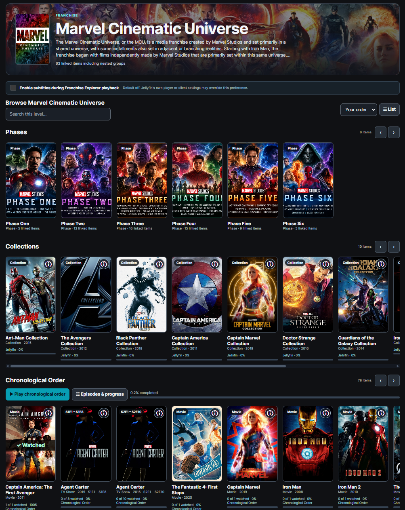

# Jellyfin Franchise Explorer

<p align="center">
  <a href="https://www.Gost1o1.pro">
    
  </a>
</p>

<p align="center">
  Create virtual franchises, eras, phases, and custom watch orders for your existing Jellyfin library—without moving or duplicating your media.
</p>

<p align="center">
  <a href="#install-or-update"></a>
  <a href="https://github.com/Gost1o1/Jellyfin-Franchise-Explorer/releases"></a>
  <a href="https://www.Gost1o1.pro"></a>
</p>

<p align="center">
  <a href="https://github.com/Gost1o1/Jellyfin-Franchise-Explorer/actions/workflows/build.yml"></a>
  <a href="https://github.com/Gost1o1/Jellyfin-Franchise-Explorer/actions/workflows/build.yml"></a>
</p>

## Preview

Explore your favorite franchises, browse phases and collections,
and follow custom chronological watch orders.



> [!IMPORTANT]
> **Experimental project for Jellyfin 12.2.** Franchise Explorer is unfinished and is being tested on a personal Jellyfin server. Features and client compatibility can change. **Back up Jellyfin and your plugin data before installing or updating.** Chronological playback and automatic next-item playback are still experimental; do not assume they work in every client.

## Install or update

1. **Back up** your Jellyfin server and Franchise Explorer configuration/artwork. The plugin's JSON export includes franchise metadata, **not the image files**.
2. In Jellyfin, open **Dashboard → Plugins → Repositories → Add** and enter the catalog URL below. If already added, keep the existing entry.
3. Open the Jellyfin plugin **Catalog**, find **Franchise Explorer**, install the available version, and **restart Jellyfin** (on Windows, restart the Jellyfin service).
4. Open the plugin's settings to create and manage franchises, then launch the **Franchises browser**.
5. **Optional:** To show a Franchises tile under **My Media** and enable supported browser-side enhancements, configure [Jellyfin JavaScript Injector](https://github.com/n00bcodr/Jellyfin-JavaScript-Injector). Support varies by client and Jellyfin Web version.

**Plugin catalog URL** — copy into Jellyfin's repository settings:

```text
https://raw.githubusercontent.com/Gost1o1/Jellyfin-Franchise-Explorer/main/manifest.json
```

**Using a GitHub download instead?** See [Releases](https://github.com/Gost1o1/Jellyfin-Franchise-Explorer/releases) for compiled plugin packages when a release is published. **Do not install GitHub's “Source code” ZIP as a Jellyfin plugin.** The Actions **Preview — Test Builds** link is for development artifacts, not a verified stable release.

## What it does

- Build virtual franchise hierarchies, such as Marvel phases or Star Wars eras.
- Arrange collections, movies, shows, seasons, and episode ranges into custom horizontal watch-order rows.
- Reuse Jellyfin artwork or apply plugin-specific poster, backdrop, logo, and banner overrides.
- Track per-user progress in an experimental chronological player, with resume options and watched indicators.
- Add an optional **Franchises** entry to Jellyfin Web's **My Media** section.

**Your existing movies, shows, files, and native Jellyfin Collections remain in place.** Normal franchise browsing does not rename, move, or duplicate library media. Plugin watch-order progress is separate from Jellyfin's native watched state.

## Need help?

- [Report a bug or request a feature](https://github.com/Gost1o1/Jellyfin-Franchise-Explorer/issues)
- [Source code and developer notes](Jellyfin-Franchise-Explorer/)
- [Development history](Jellyfin-Franchise-Explorer/CHANGELOG.md)
- [Build and browser tests](https://github.com/Gost1o1/Jellyfin-Franchise-Explorer/actions/workflows/build.yml)
- [Visit Gost1o1.pro](https://www.Gost1o1.pro)

## License and credits

[**Personal and Noncommercial Use License (Draft) v0.1**](LICENSE). This is a custom source-available license, **not an OSI-approved open-source license**. Commercial use requires separate written permission; third-party software and artwork retain their own terms.

Created by **Quinton Burgess (Gost1o1)**, with development assistance from **ChatGPT (OpenAI GPT-6)**. Project direction, configuration, and hands-on Jellyfin testing are by Gost1o1. Testing on one server is not a compatibility guarantee.

> [!CAUTION]
> **UNFINISHED PROJECT — USE WITH CAUTION.** Make backups and test new versions with a short timeline before relying on playback automation.
