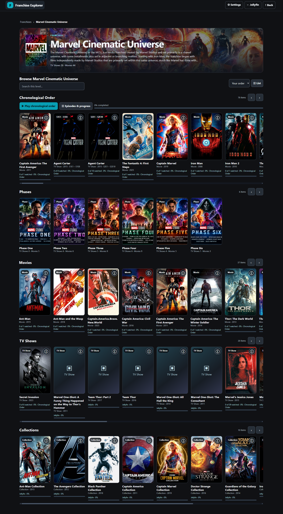
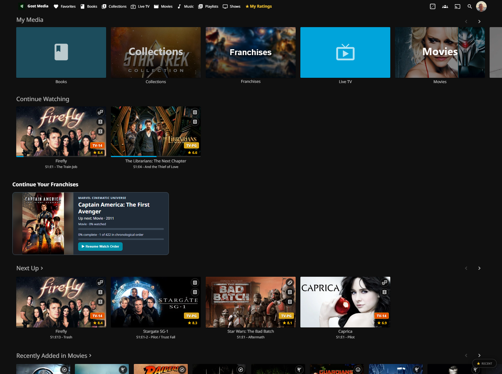
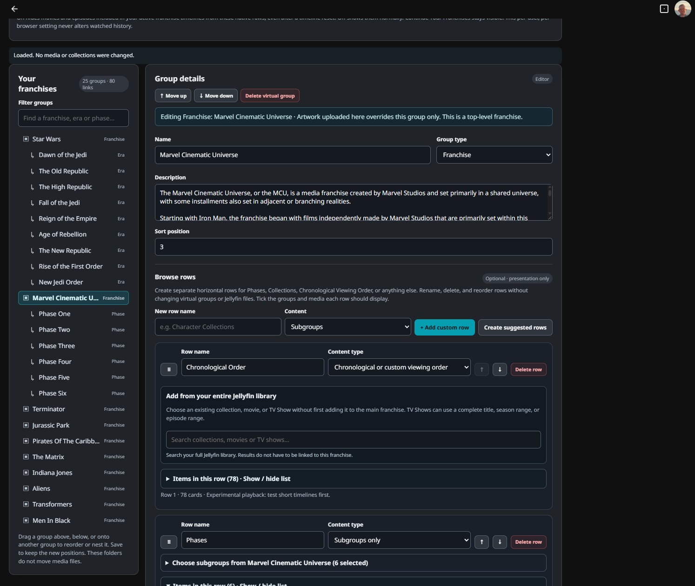
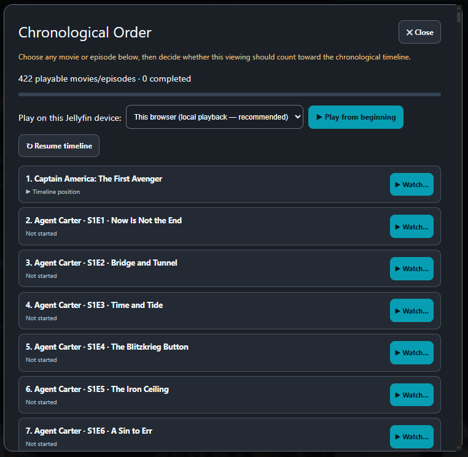
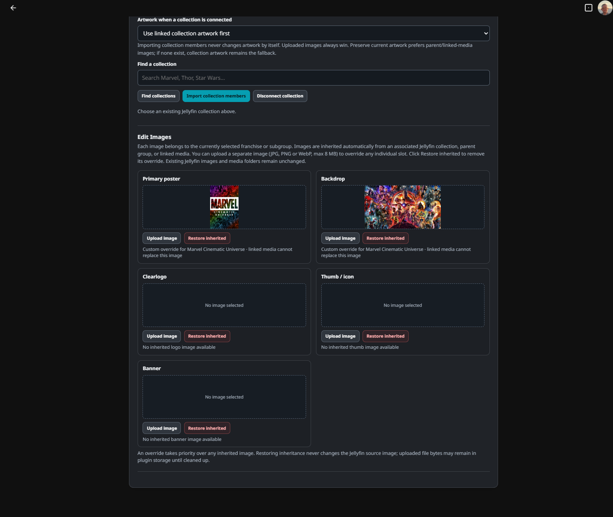
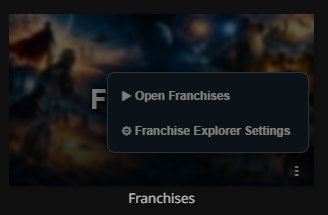
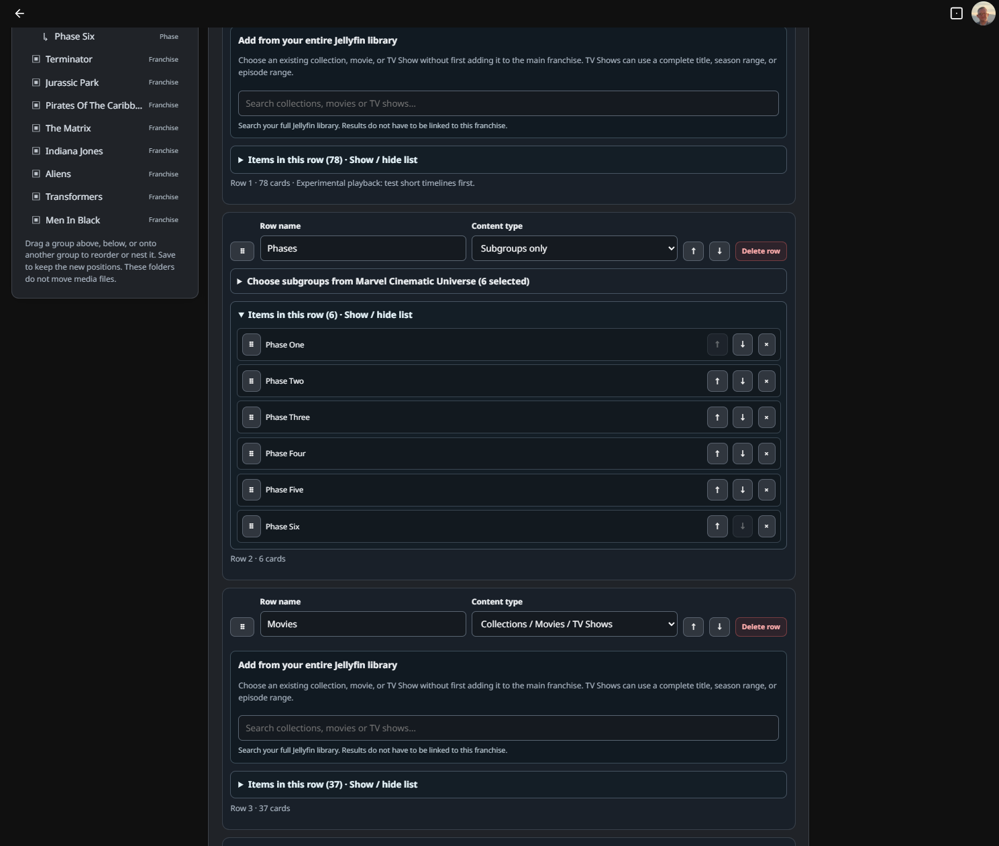
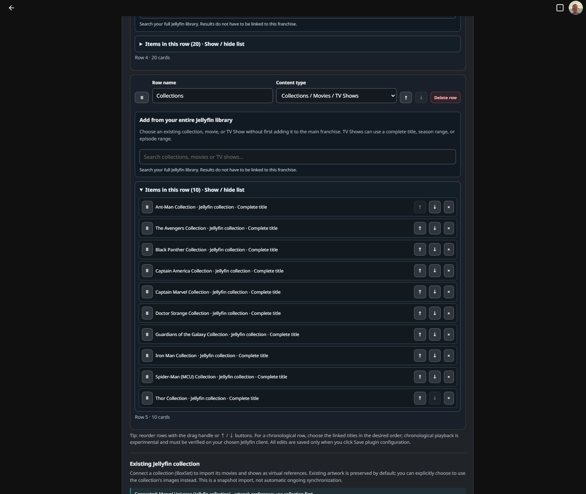
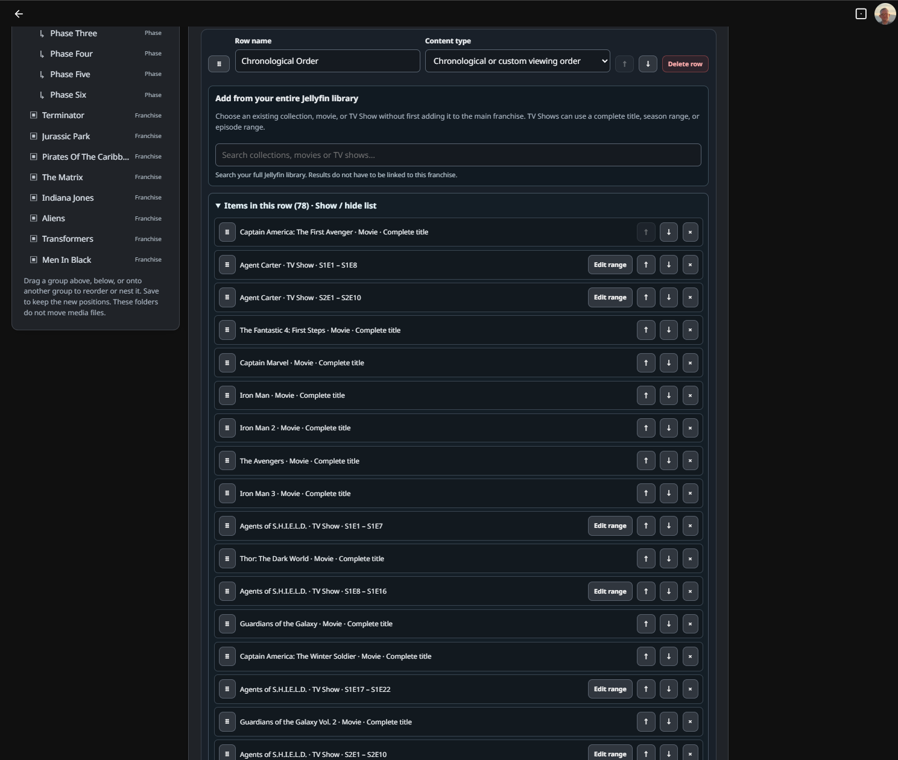

# Jellyfin Franchise Explorer

<p align="center">
  <a href="https://www.Gost1o1.pro">
    
  </a>
</p>

<p align="center">
  Create virtual franchises, eras, phases, and custom watch orders for your existing Jellyfin library—without moving or duplicating your media.
</p>

<p align="center">
  <a href="#install-or-update"></a>
  <a href="https://github.com/Gost1o1/Jellyfin-Franchise-Explorer/releases"></a>
  <a href="https://www.Gost1o1.pro"></a>
</p>

<p align="center">
  <a href="https://github.com/Gost1o1/Jellyfin-Franchise-Explorer/actions/workflows/build.yml"></a>
  <a href="https://github.com/Gost1o1/Jellyfin-Franchise-Explorer/actions/workflows/build.yml"></a>
</p>

> [!IMPORTANT]
> **Experimental project for Jellyfin 12.2.** Franchise Explorer is unfinished and is being tested on a personal Jellyfin server. Features and client compatibility can change. **Back up Jellyfin and your plugin data before installing or updating.** Chronological playback and automatic next-item playback are still experimental; do not assume they work in every client.

## Preview

### Franchise Explorer in action

Browse a complete franchise in one place, with a chronological watch order, phases, movies, TV shows, and collections. This is a **single vertically stitched screenshot** of the current browser, captured from the three screenshots supplied for v0.8.9.15.



### Your franchises, right on Jellyfin Home

The **Franchises** tile sits beside your other libraries. **Continue Your Franchises** displays the current movie or series poster, upcoming episode, progress, and **Resume Watch Order**. The intent on a supported Jellyfin Web client is to start the video directly without navigating through the browsing or Details pages.



### Organize franchises, phases, and watch orders

The main **Franchise Explorer settings editor** lets you build virtual hierarchies, create custom rows, select movies and episode ranges from your Jellyfin library, and put entries in exactly the order you want.



### Pick where to start watching

Open your chronological list from the homepage card's menu. Choose a particular movie or episode, then decide whether to **watch it once** or **count it toward your franchise timeline**. The menu also lets you restart the current item, reset chronological history, or open Details on purpose.



### Make every franchise look the way you want

Upload separate posters, backdrops, clearlogos, icons, and banners—or use inherited artwork from existing Jellyfin collections and linked titles. Restoring an inherited slot does not change the original media artwork.



*Screenshots show one example library and configuration, not bundled content. Direct playback and automatic next-item handoff are experimental and can vary by Jellyfin client.*

See the [Marvel Cinematic Universe example walkthrough](#example-setup-marvel-cinematic-universe) for more screenshots, or jump to the [illustrated user guide](docs/USER_GUIDE.md) for detailed instructions.

**New to Franchise Explorer?** Start with the [complete illustrated user guide](docs/USER_GUIDE.md). It explains every editor field and button, how to resume directly from Jellyfin Home, use the card's three-dot menu, choose whether a selected episode counts toward chronological progress, set up franchises and subgroups, link Jellyfin media, create chronological rows, and manage artwork. The guide includes **20 screenshots** of the v0.8.9.15 Home and scrolling settings interface.

## Install or update

Franchise Explorer has a standalone Franchises browser, but its **My Media tile, Continue Your Franchises homepage tracker, and tile settings menu require the separate [JavaScript Injector plugin](https://github.com/n00bcodr/Jellyfin-JavaScript-Injector)**. Install both plugins for the complete Jellyfin Web experience. JavaScript Injector is not bundled with Franchise Explorer.

### Step 1 — Add both plugin repositories

1. Open **Jellyfin Dashboard → Plugins → Repositories**.
2. Select **Add** (or the **+** button).
3. Give the first repository the name **Gost1o1 — Franchise Explorer** and paste this URL:

```text
https://raw.githubusercontent.com/Gost1o1/Jellyfin-Franchise-Explorer/main/manifest.json
```

4. Save, select **Add** again, name the second repository **n00bcodr — JavaScript Injector**, and paste the repository URL from the [JavaScript Injector project's installation instructions](https://github.com/n00bcodr/Jellyfin-JavaScript-Injector#installation). The maintainer states the same catalog URL supports Jellyfin 10.11 and 12:

```text
https://raw.githubusercontent.com/n00bcodr/jellyfin-plugins/main/manifest.json
```

5. Save. If either repository is already present, keep its existing entry rather than creating a duplicate.

### Step 2 — Install the plugins

1. **Back up** Jellyfin and your Franchise Explorer configuration and artwork. The plugin's JSON export includes franchise metadata, **not uploaded image files**.
2. Open **Dashboard → Plugins → Catalog**. Install the Jellyfin 12-compatible **JavaScript Injector** plugin and **Franchise Explorer** from their respective repositories.
3. **Restart Jellyfin** after installing or updating either plugin (on Windows, restart the Jellyfin service).
4. Open **Dashboard → Plugins → JavaScript Injector** (or **JS Injector** in the dashboard sidebar). Under **Plugin Scripts**, you should see **one enabled Franchise Explorer - My Media tile** entry registered by Franchise Explorer itself. In **v0.8.9.15**, its Script ID is `jellyfin-franchise-explorer-my-media-v08915` and Plugin Version is `0.8.9.15`. You do **not** need to click **Add Script** or paste JavaScript manually when this entry is present.
5. Hard-refresh Jellyfin Web with **Ctrl+Shift+R**, then check **Home → My Media → Franchises**, **Continue Your Franchises**, and the separate **Franchises browser**. On a desktop, hover over (or keyboard-focus) the Franchises artwork to reveal its three-dot settings menu. On touch devices the button remains visible. Clicking the rest of the tile opens browsing.
6. Open Franchise Explorer settings to create or manage franchises and chronological watch orders.

**Already installed JavaScript Injector?** Keep the one registered Franchise Explorer plugin script enabled. Avoid creating a second, manually pasted copy; conflicting older scripts can interfere with the homepage integration. Version **0.8.9.15** registers a new script ID and attempts to retire only the old plugin-owned `jellyfin-franchise-explorer-my-media-v08914`, `jellyfin-franchise-explorer-my-media-v08913`, `jellyfin-franchise-explorer-my-media-v08912`, `jellyfin-franchise-explorer-my-media-v08911`, `jellyfin-franchise-explorer-my-media-v08910`, `jellyfin-franchise-explorer-my-media-v0899`, `jellyfin-franchise-explorer-my-media-v0898`, `jellyfin-franchise-explorer-my-media-v0897`, `jellyfin-franchise-explorer-my-media-v0896`, `jellyfin-franchise-explorer-my-media-v0895`, `jellyfin-franchise-explorer-my-media-v0894`, `jellyfin-franchise-explorer-my-media-v0893`, and `jellyfin-franchise-explorer-my-media-v1` entries. If multiple IDs remain, confirm the new script is installed before disabling the old entries. If the browser still displays an older tracker, verify the installed DLL version, restart Jellyfin, and try a private browsing window to rule out cached web assets.

**Franchise title visibility:** Open **Dashboard → Plugins → Franchise Explorer → Playback & Home preferences** and find **Hide franchise titles from Continue Watching and Next Up**. It defaults to **off**, so native Jellyfin titles remain visible. Turn it **on** to hide movies and episodes linked to your active franchise chronological timelines from those two native home rows, including previously viewed episodes after a timeline reset. Unrelated titles remain visible, and the **Continue Your Franchises** card is unchanged. This is a **per-user, per-browser display preference**; configure it separately on other browsers/devices. No Jellyfin watched/resume records are altered. The **Enable subtitles** checkbox is also on the plugin settings page.

**Still seeing an older layout?** v0.8.9.15 displays the root franchise name, the current series or movie, the next episode (where applicable), Primary poster artwork in both portrait and landscape layouts (with a blurred poster backdrop), and progress. The My Media tile includes cinematic ensemble artwork, with **Franchises** centered and a softened background; its three-dot menu stays **inside the bottom-right of the tile artwork**. The root browsing page displays franchise posters directly with **TV Shows / Movies** counts, no extra subsection heading, and **Your order** as the navigation default. On the Continue Your Franchises card, its three-dot menu works **without opening the Franchises browser**: **Restart chronological history** opens a small centered confirmation asking whether to reset the named franchise; **Restart current viewing** starts the current video at 0:00, preserving earlier timeline history; **Select from chronological list** displays the full existing scrolling list as a centered popup **over Jellyfin Home**, exactly as in the homepage layout. The player choices and tracked vs one-off viewing options remain. This release also intercepts stale navigation links from older Injector scripts, but you should still disable duplicate manual scripts. Long lists in the editor can be collapsed. In Jellyfin Web's browser DevTools Console, run `window.__franchiseExplorerUiVersion` to check the actual script; it should return `0.8.9.15`. The tracker marker `document.querySelector('#franchise-timeline-resume')?.dataset.feVersion` should also report `0.8.9.15`. If an older marker remains, verify the installed DLL, restart Jellyfin and hard-refresh. See [v0.8.9.15 upgrade notes](Jellyfin-Franchise-Explorer/docs/UPGRADE_V08915.md).

**Homepage progress bars:** The **Continue Your Franchises** card displays the current movie or episode's playback progress first, then the number of episodes completed in the current configured TV range (only if that range contains multiple episodes), followed by overall chronological progress. Adjacent ranges from the same TV show are counted separately. These counters reflect Franchise Explorer timeline state, not unrelated Jellyfin watched records.

**v0.8.9.15 direct playback:** Click the poster or **Resume Watch Order** on Jellyfin Home to play the current movie/episode at its saved position **without opening the Franchises browser or the chronological list**. Once an episode finishes and verified chronology advances, the next item is scheduled through the Home native player bridge; no Details-page route is used. If Jellyfin Web cannot start its native player, an error stays on Home without falsely advancing history. The three-dot **Details** action is the only intended navigation to the item's Details page. The Continue card prefers the same Primary poster artwork at every screen orientation.

**Using a GitHub download instead?** See [Releases](https://github.com/Gost1o1/Jellyfin-Franchise-Explorer/releases) for compiled plugin packages when a release is published. **Do not install GitHub's “Source code” ZIP as a Jellyfin plugin.** The Actions **Preview — Test Builds** link is for development artifacts, not a verified stable release.

**v0.8.9.15 playback update:** Clicking a playable movie or episode in the Franchises browser now transfers a short-lived play request to Jellyfin Web's Home view, where the JavaScript Injector bridge attempts to invoke Jellyfin's native player directly. The **Restart current viewing** shortcut explicitly uses **Play from 0:00**, not Jellyfin's independently remembered **Resume** position. If a Jellyfin Web client cannot play directly, it reports the problem on Home instead of automatically opening Details. The reset prompt is a centered in-page dialog, not a browser-native confirmation. These behaviors are covered by offline contracts and still need confirmation on a live Jellyfin server.

**v0.8.9.15 Home navigation:** The Continue Your Franchises card's three-dot menu includes **Details** for the current playable title. Franchise playback remembers the same-tab page you came from: when Jellyfin returns to that title's Details after closing the player, the Web bridge returns you to the original Home or Franchises browser page. This only applies to franchise-started playback and does not hijack an intentionally opened Details page. The enabled hide setting now covers the franchise's entire saved chronological queue rather than just its current entry.

**Developer note:** Pushing updated source files or passing GitHub Actions does **not** update the plugin already installed on your Jellyfin server. Publish and install the compiled release (or explicitly deploy a compatible test DLL), restart Jellyfin, then refresh the browser. A newer source version may not appear in the Jellyfin catalog until that version is actually released and added to the repository manifest.

## Example setup: Marvel Cinematic Universe

The screenshots below show an **example configuration**, not franchises or media included with the plugin. They use an existing Jellyfin library with artwork already available. Your titles, posters, phases, and watch order will depend on the media and groups you add.

For explanations of **all** available settings and controls, see [How to use Franchise Explorer](docs/USER_GUIDE.md).

### 1. Create a franchise and organize its groups

Open **Dashboard → Plugins → Franchise Explorer**. Create a top-level franchise (for example, **Marvel Cinematic Universe**), then add subgroups for its phases. Select a group to set its name, description, order, artwork, and optional **Browse rows**. Use the rows to decide how subgroups, collections, and watch-order entries appear to viewers. Changes to these virtual groups do not move your Jellyfin media files.


### 2. Open the Franchises browser

Select **Open Franchises browser** from the editor, or open **Franchises** from Jellyfin Web's **My Media** row. The top level displays franchise posters directly, with no redundant introductory banner or duplicate "Groups and subgroups" heading. Franchise cards show separate counts for distinct TV shows and movies; entering a franchise defaults to **Your order** while still allowing A–Z sorting. Click the top-left **F logo / Franchise Explorer title** at any level to return to **Your franchises**. The playback and native home-row visibility checkboxes live in **Dashboard → Plugins → Franchise Explorer** under **Playback & Home preferences**, rather than on the browsing page.



### 3. Configure a franchise's phases and collections

Select **Marvel Cinematic Universe** in the editor and configure separate **Phases** and **Collections** browse rows. Expand each row to choose the linked phase subgroups or existing Jellyfin collections and arrange their display order. These are references to your existing media and virtual groups, not duplicate Jellyfin libraries.





### 4. Arrange and play a chronological watch order

Add movies, shows, seasons, or episode ranges to a chronological row in the editor. In the browser, scroll to **Chronological Order** to review the sequence, track progress, or choose **Play chronological order**. The progress indicators show Franchise Explorer's watch-order state; they are not a replacement for Jellyfin's native watched status. Playback and automatic handoff between items remain experimental.



### 5. Resume from the Jellyfin homepage

With **JavaScript Injector** and the registered Franchise Explorer script enabled, Jellyfin Web shows a **Franchises** tile under **My Media** and a **Continue Your Franchises** card for a started watch order. The card shows the current title, next episode, completion progress, and **Resume Watch Order**. This example also shows the hide-active-title setting **on**, so **Agent Carter** remains in the franchise resume card but is absent from the regular **Continue Watching** and **Next Up** rows. Other, unrelated titles remain visible.


All README feature screenshots come from the **new v0.8.9.15 images**, stored in [`docs/screenshots/user-guide/`](docs/screenshots/user-guide/).

## What it does

- Build virtual franchise hierarchies, such as Marvel phases or Star Wars eras.
- Arrange collections, movies, shows, seasons, and episode ranges into custom horizontal watch-order rows.
- Reuse Jellyfin artwork or apply plugin-specific poster, backdrop, logo, and banner overrides.
- Track per-user progress in an experimental chronological player, with resume options and watched indicators.
- Add an optional **Franchises** entry to Jellyfin Web's **My Media** section.
- Resume different franchise watch orders from persistent homepage cards showing the next title, artwork, and individual progress (on supported Jellyfin Web installations).
- Show the current **movie/series poster** on the Continue Your Franchises card in **portrait and landscape**, with blurred background fill where needed, instead of swapping to separate wide artwork.
- Optionally hide the active watch-order show/movie from **Continue Watching** and **Next Up** while keeping it in **Continue Your Franchises** (Jellyfin Web only).
- Reveal the My Media Franchises tile options on **desktop hover or keyboard focus**; leave them visible for touch input.
- Open Franchise Explorer's administrator settings from the My Media Franchises tile or the browser header.

**Your existing movies, shows, files, and native Jellyfin Collections remain in place.** Normal franchise browsing does not rename, move, or duplicate library media. Plugin watch-order progress is separate from Jellyfin's native watched state.

## Need help?

- [Step-by-step setup and complete settings reference](docs/USER_GUIDE.md)
- [Report a bug or request a feature](https://github.com/Gost1o1/Jellyfin-Franchise-Explorer/issues)
- [Source code and developer notes](Jellyfin-Franchise-Explorer/)
- [Development history](Jellyfin-Franchise-Explorer/CHANGELOG.md)
- [Build and browser tests](https://github.com/Gost1o1/Jellyfin-Franchise-Explorer/actions/workflows/build.yml)
- [Visit Gost1o1.pro](https://www.Gost1o1.pro)

## License and credits

[**Personal and Noncommercial Use License (Draft) v0.1**](LICENSE). This is a custom source-available license, **not an OSI-approved open-source license**. Commercial use requires separate written permission; third-party software and artwork retain their own terms.

Created by **Quinton Burgess (Gost1o1)**, with development assistance from **ChatGPT (OpenAI GPT-6)**. Project direction, configuration, and hands-on Jellyfin testing are by Gost1o1. Testing on one server is not a compatibility guarantee.

> [!CAUTION]
> **UNFINISHED PROJECT — USE WITH CAUTION.** Make backups and test new versions with a short timeline before relying on playback automation.
