# Franchise Explorer user guide

**Applies to experimental v0.8.9.15 on Jellyfin 12.2.** This illustrated guide covers installation, watching and resuming a franchise, the Home card menu, configuring virtual groups and browse rows, selecting TV episode ranges, and artwork. Screenshots show one user's Marvel Cinematic Universe library; **the plugin does not supply these movies, shows, images, or watch orders**.

> [!IMPORTANT]
> Back up Jellyfin and Franchise Explorer's configuration **and uploaded artwork** before experimenting. Franchises are virtual references to existing Jellyfin items; they do **not** move, rename, copy, or delete your media. Chronological playback is experimental and not guaranteed on every Jellyfin client.

## Contents

1. [What the pieces mean](#what-the-pieces-mean)
2. [Install Franchise Explorer and JavaScript Injector](#install-franchise-explorer-and-javascript-injector)
3. [Watch and resume from Jellyfin Home](#watch-and-resume-from-jellyfin-home)
4. [Choose an item from a chronological timeline](#choose-an-item-from-a-chronological-timeline)
5. [Open and configure the plugin](#open-and-configure-the-plugin)
6. [Example: build a Marvel Cinematic Universe franchise](#example-build-a-marvel-cinematic-universe-franchise)
7. [Administrator editor: every control explained](#administrator-editor-every-control-explained)
8. [Artwork and inherited images](#artwork-and-inherited-images)
9. [Add existing Jellyfin media and episode ranges](#add-existing-jellyfin-media-and-episode-ranges)
10. [Set up browse rows and chronological viewing order](#set-up-browse-rows-and-chronological-viewing-order)
11. [Screenshots of the scrolling settings editor](#screenshots-of-the-scrolling-settings-editor)
12. [Franchises browser and viewer preferences](#franchises-browser-and-viewer-preferences)
13. [Jellyfin homepage and mobile behavior](#jellyfin-homepage-and-mobile-behavior)
14. [Backups, troubleshooting, and current limitations](#backups-troubleshooting-and-current-limitations)

## What the pieces mean

| Term | Purpose | Example |
| --- | --- | --- |
| **Franchise** | Top-level virtual group; displayed in the Franchises browser. | Marvel Cinematic Universe |
| **Subgroup** | A nested virtual group, which can be marked as an Era, Phase, Saga, Character, Collection, or Custom group. | Phase One under Marvel Cinematic Universe |
| **Linked Jellyfin media** | A reference to an existing Jellyfin title or a selected TV show range. The original item stays in its library. | *Agent Carter*, seasons 1–2 |
| **Browse row** | A horizontal presentation row you configure for one franchise or subgroup. | Phases, Collections, Chronological Viewing Order |
| **Chronological / custom viewing order** | A browse row whose titles are ordered for sequential viewing, with separate progress. | A movie followed by selected *Agent Carter* episodes |
| **Continue Your Franchises** | Jellyfin Web homepage card for resuming an active Franchise Explorer watch order. | Next episode and percent complete |

The **Group type** label helps organize browsing; naming a group **Collection** does not create a new native Jellyfin collection.

## Install Franchise Explorer and JavaScript Injector

1. In **Jellyfin Dashboard → Plugins → Repositories**, add the Franchise Explorer catalog URL:

   ```text
   https://raw.githubusercontent.com/Gost1o1/Jellyfin-Franchise-Explorer/main/manifest.json
   ```

2. Add the JavaScript Injector catalog URL as a second repository:

   ```text
   https://raw.githubusercontent.com/n00bcodr/jellyfin-plugins/main/manifest.json
   ```

3. Under **Plugins → Catalog**, install **Franchise Explorer** and a **Jellyfin 12-compatible JavaScript Injector**. Restart the Jellyfin service after installing or updating.
4. In **Dashboard → Plugins → JS Injector**, expand **Plugin Scripts**. Confirm an enabled **Franchise Explorer - My Media tile** script. For v0.8.9.15, its script ID is `jellyfin-franchise-explorer-my-media-v08915`.
5. **Do not manually add a duplicate script** if the plugin-owned one is present. Hard-refresh Jellyfin Web (**Ctrl+Shift+R** on a desktop) after the restart.

The JavaScript Injector companion is required for the **My Media** tile, homepage resume card, and tile menu in Jellyfin Web. The standalone Franchises browser and administrator editor are provided by Franchise Explorer itself. The companion does not add a Franchises category to native TV/mobile applications.

For installation details and troubleshooting, see the [repository README](../README.md#install-or-update).

## Watch and resume from Jellyfin Home

Once the JavaScript Injector companion is active, Jellyfin Web shows **Franchises** next to **Collections** under **My Media** and a **Continue Your Franchises** section for an active viewing order.


1. Select the main **Franchises** tile to browse your virtual library. Use the **three-dot** button *inside* the tile if you want **Open Franchises** or **Franchise Explorer Settings** instead.
2. The **Continue Your Franchises** card displays the root franchise, current movie or TV series, next episode when applicable, and watch-order progress.
3. Press **Resume Watch Order** to ask Jellyfin Web to **play the next movie or episode directly**. On the supported Web client the intent is to remain on Jellyfin Home behind the player, without opening the Franchise Explorer browsing page, a chronological-list dialog, or Jellyfin's title Details page first.
4. Once a title finishes naturally, the experimental player should attempt the **next playable episode or movie directly**. If it opens Details instead or returns to the browser, see [Troubleshooting](#troubleshooting) and report your Jellyfin and plugin versions: live client behavior may differ.
5. Select **Details** only when you want information about the current title.

The Home card uses the **current movie or series poster in portrait *and* landscape orientations**; its wide layout retains the poster rather than swapping to a landscape thumbnail. Empty space may be filled with a blurred rendition of the poster.

### Home card's three-dot menu

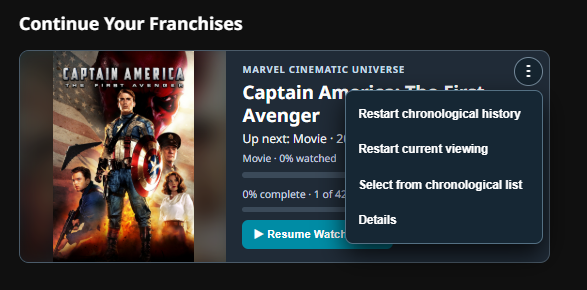

| Action | What to expect |
| --- | --- |
| **Restart chronological history** | Ask for confirmation, then clear this franchise's recorded chronological progress so you can begin the timeline again. This does not delete videos or reset Jellyfin's native watched flags. |
| **Restart current viewing** | Start the **current movie or episode from 0:00**, preserving previous timeline entries. This differs from resuming from a saved playback position. |
| **Select from chronological list** | Open the full scrolling timeline in a modal **over Home**, so you can jump to a specific movie/episode. |
| **Details** | Open Jellyfin's Details page intentionally for the current title. |

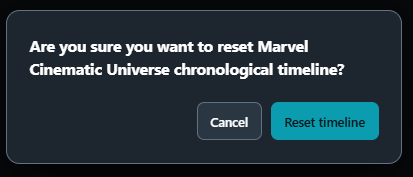

> [!NOTE]
> The popup menu should not navigate away merely because you open it. **Reset timeline** is a deliberate action requiring confirmation. For reliable results, test the direct-play and next-item handoff on your installed Jellyfin Web client.

## Choose an item from a chronological timeline

Selecting **Select from chronological list** displays a scrollable **Chronological Order** overlay. The screenshot's 422 entries are from the example library, not a fixed list shipped with the plugin.


1. Choose **Play on this Jellyfin device** (for example, *This browser — local playback*).
2. Use **Play from beginning** to start the defined timeline, or **Resume timeline** to continue the current sequence.
3. For a particular movie or episode, press its **Watch…** button.
4. Choose whether this watch should affect franchise progress:
   - **Watch only · No franchise tracking** plays just that title without repositioning Franchise Explorer's chronological timeline. Jellyfin itself may still update its normal watched/resume records.
   - **Watch and track from here** moves the franchise timeline to that selected item. The plugin asks for confirmation because later recorded entries in that franchise timeline can be cleared.
5. Confirm **Watch and track** to proceed, or **Cancel** to keep the current timeline.

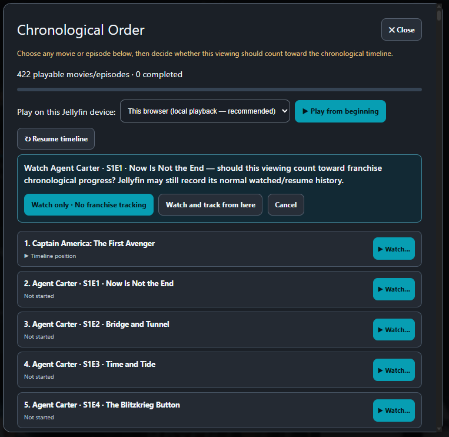

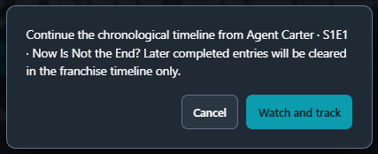

These are **franchise timeline** controls, not file operations. Playing an episode normally through Jellyfin may affect Jellyfin's own playback history even when franchise tracking is disabled.

## Open and configure the plugin

In **My Media**, hover over the **Franchises** artwork on desktop (or focus the tile with a keyboard) to reveal the three-dot menu; on touch layouts the menu can remain visible.


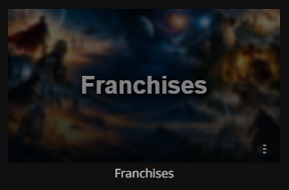

- **Open Franchises** opens the viewer-facing virtual franchise browser.
- **Franchise Explorer Settings** opens the administrator editor. You can also open it through **Dashboard → Plugins → Franchise Explorer**.
- For access to editor features you need the relevant Jellyfin administrator permissions. The **Franchises** library tile itself is meant for viewing.

The next sections cover the editor in the same top-to-bottom order as the screenshots.

## Example: build a Marvel Cinematic Universe franchise

You can use a completely different universe; the screenshots below show one personally configured example, **not media or artwork packaged with Franchise Explorer**.

### Step 1 — Create the virtual hierarchy

1. Open **Dashboard → Plugins → Franchise Explorer**.
2. Select **+ New franchise**, then change **Name** to `Marvel Cinematic Universe` and **Group type** to **Franchise**.
3. With it selected, click **+ Subgroup**. Rename the subgroup **Phase One** and change its group type to **Phase**.
4. Select the parent franchise again, then repeat for **Phase Two** through **Phase Six**.
5. Drag groups in the left hierarchy, or use **↑ Move up / ↓ Move down**, to adjust their order. The **Sort position** field is another way to set the relative order.

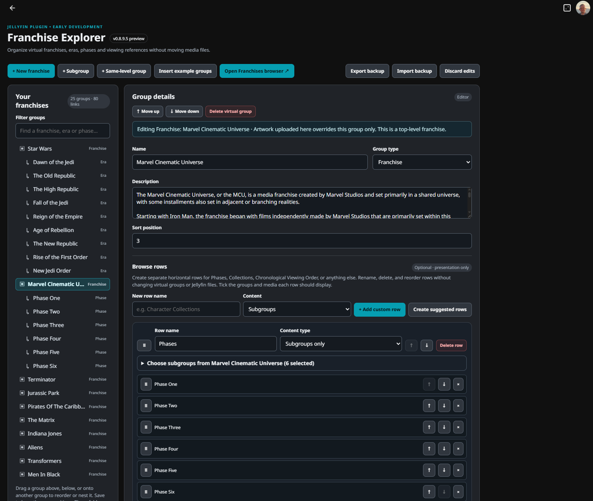

### Step 2 — Add existing titles

1. Select the appropriate phase or other group in **Your franchises**.
2. Open **Browse rows**, add a row with **Movies / TV shows** or **Chronological / custom viewing order**, and expand its media selector.
3. Search your Jellyfin library by title (at least two characters), then select the movies or TV shows for the row.
4. For TV shows, use **Choose TV Show range** if only certain seasons/episodes belong in that group. These links are virtual and do not copy files.

You can also connect an existing Jellyfin collection under **Existing Jellyfin collection**, then optionally **Import collection members** as a one-time snapshot. See [collection controls](#connect-an-existing-jellyfin-collection) below.

### Step 3 — Add artwork

Select the franchise or phase, then scroll to **Edit Images**. Upload a **Primary poster** and (optionally) a **Backdrop**, **Clearlogo**, **Thumb / icon**, and **Banner**. Artwork applied to a phase belongs to that phase; it does not overwrite its parent or the original Jellyfin items. If you do not upload an override, the plugin attempts to inherit images from relevant existing artwork.

### Step 4 — Create separate browse rows

1. Select **Marvel Cinematic Universe** and go to **Browse rows**.
2. Click **Create suggested rows** to generate applicable categories based on your existing groups, or add rows manually:
   - **Phases** → **Subgroups**; tick the six phase groups.
   - **Collections** → **Collections / Movies / TV Shows**; select existing native Jellyfin collections. If you organize collection-like virtual subgroups instead, you can also create a separate **Subgroups** row for those.
   - **Chronological Order** → **Chronological / custom viewing order**; add titles from your full Jellyfin library in the exact order you want to watch them.
3. Use each row's **⠿ drag handle** or **↑ / ↓** controls to set its position. Use the included items' own reorder controls to arrange their sequence.
4. Click **Save plugin configuration** at the **top of the editor**. Most changes are only drafts until this button is clicked.

### Step 5 — See the browsing result

Click **Open Franchises browser** near the editor's top toolbar. Your new franchise should appear on the main Franchises page, with a poster if artwork is available.

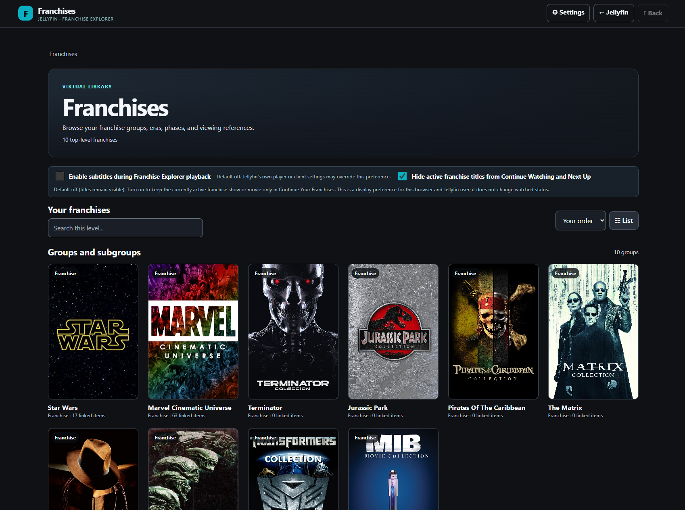

Click the franchise to see its banner and configured rows.

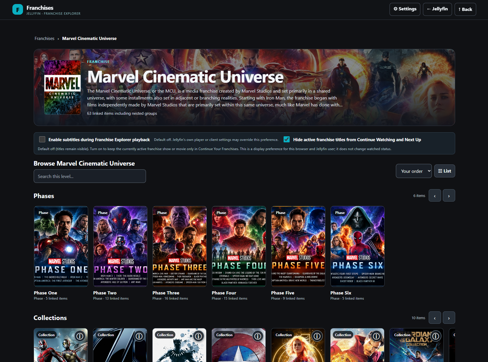

Scroll to **Chronological Order** to review title order, range labels, and progress. A **Play chronological order** control is available for a populated watch-order row on supported Jellyfin Web installations; test it with a short sample timeline first.

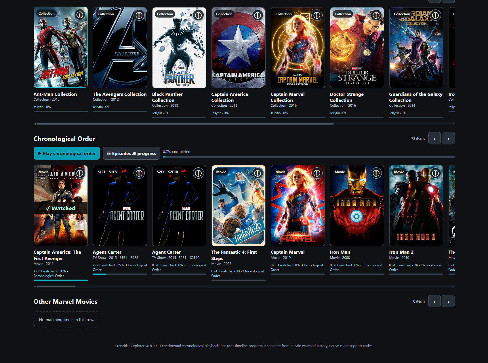

### Step 6 — Resume from Jellyfin Web's homepage

After starting a supported chronological watch order, return to Jellyfin Web's homepage. The **Continue Your Franchises** card can show the franchise, current movie/series, next episode, progress, and **Resume Watch Order**.

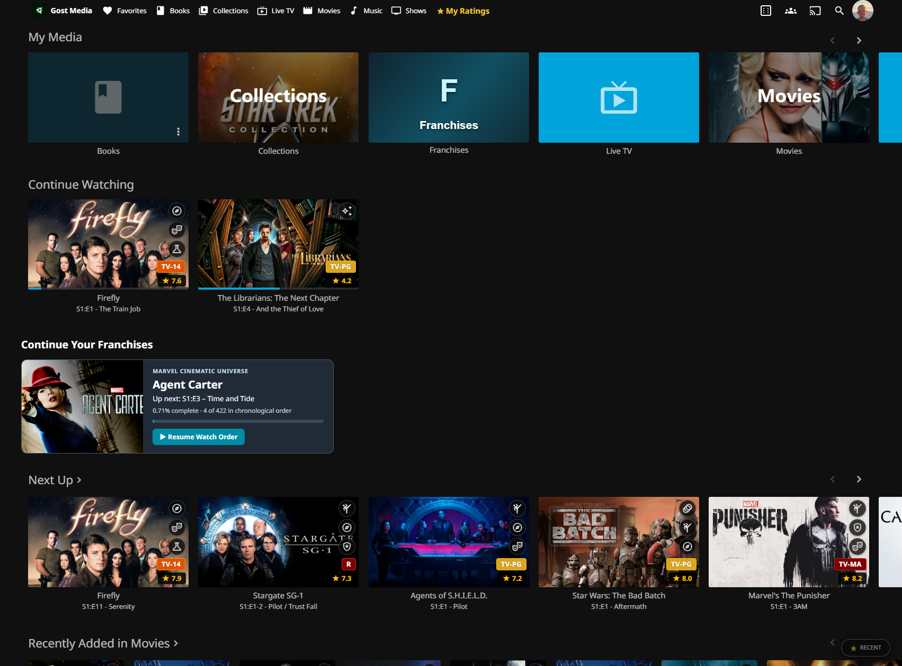

## Administrator editor: every control explained

Open **Dashboard → Plugins → Franchise Explorer**. This is the **editor**; it is different from the viewer-facing **Franchises browser**.

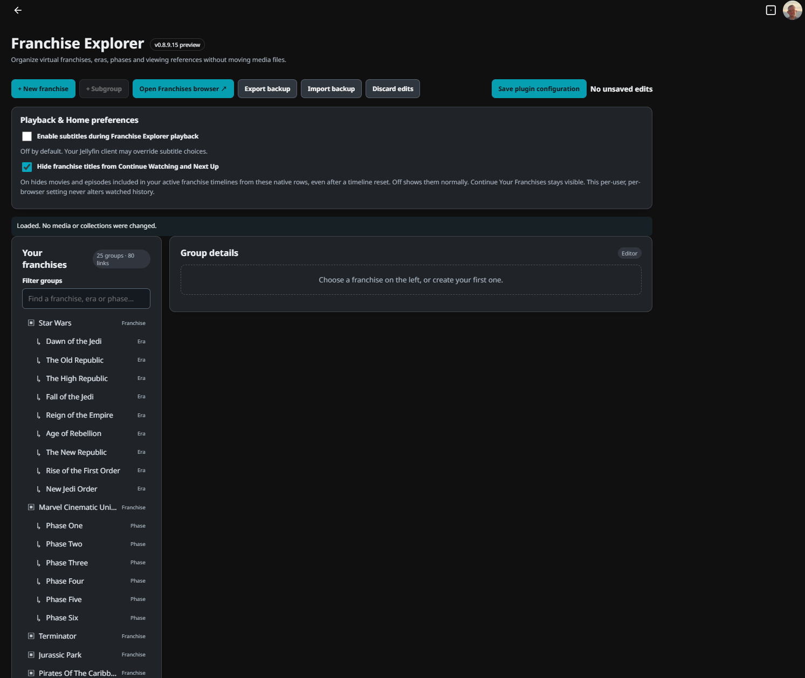

The editor is a **long scrolling page**. First choose a group in the left panel; the right panel changes to the selected group. Scroll down within the page for Browse rows, Existing Jellyfin collection, and Edit Images. The screenshots in this guide are preserved in **vertical scroll order** below, so you can follow the page without having to reassemble it.

### Top toolbar

| Control | What it does |
| --- | --- |
| **+ New franchise** | Adds a new top-level group. Rename it in **Group details** and save. |
| **+ Subgroup** | Adds a child under the currently selected group. Useful for an era, phase, saga, or character grouping. |
| **Open Franchises browser ↗** | Opens the separate browsing page, where you can inspect the saved structure and start supported watch orders. |
| **Export backup** | Downloads a JSON snapshot of the virtual configuration to your device. It can contain item IDs; **it does not include uploaded artwork files**. |
| **Import backup** | Loads a compatible JSON backup into the *unsaved* editor workspace. Confirm, review, then **Save plugin configuration** to persist. It replaces your current unsaved workspace, not Jellyfin media. |
| **Discard edits** | Reloads the saved configuration, abandoning unsaved changes after confirmation. |
| **Save plugin configuration** | The primary **top-right** action. Persists virtual groups, row definitions, existing references, and artwork settings. |

### Your franchises (left panel)

| Control | What it does |
| --- | --- |
| **Filter groups** | Searches the existing virtual group hierarchy, not the Jellyfin media library. |
| **Click a franchise/subgroup** | Selects it for editing in the right panel. |
| **Drag above, below, or onto a group** | Reorders sibling groups or nests a group inside another, without moving media. |
| **↑ Move up / ↓ Move down** | Moves the selected group relative to siblings when drag-and-drop is inconvenient. |
| **Delete virtual group** | Removes the selected virtual group after confirmation. It does **not** delete the corresponding movie files, shows, or native Jellyfin collections. Back up before making structural changes. |

### Group details (right panel)

| Field | What it controls |
| --- | --- |
| **Name** | Display title for the selected franchise or subgroup. |
| **Group type** | Semantic category: **Franchise**, **Era**, **Phase**, **Saga**, **Character**, **Collection**, or **Custom**. This is a virtual organization label. |
| **Description** | Optional text shown in the franchise browsing header. |
| **Sort position** | Numeric ordering among sibling groups. Moving or dragging groups can also update order. |
| **Artwork scope message** | Reminds you that uploaded images affect **only the selected group**. |


### Status and preferences (top of editor)

| Control | What it does |
| --- | --- |
| **Playback & Home preferences** | The subtitle and native-row visibility switches are located here, rather than on the franchise browsing page. These changes save immediately in the current browser. |
| **Save plugin configuration** | Persists changes to virtual groups, row definitions, media references, and artwork settings. Watch for the status message near the top of the editor. |
| **No unsaved edits / unsaved indicator** | Helps you tell whether the editor contains uncommitted changes. |

In the screenshots **Enable subtitles during Franchise Explorer playback** is unchecked, and **Hide franchise titles from Continue Watching and Next Up** is checked. This is an example configuration, **not** proof that hiding is enabled by default.

## Artwork and inherited images

The **Edit Images** section has five independent slots:

| Image slot | Intended use |
| --- | --- |
| **Primary poster** | Portrait poster for franchise or subgroup cards. |
| **Backdrop** | Wide background in the franchise detail header. |
| **Clearlogo** | Logo artwork where the UI can use it. |
| **Thumb / icon** | Alternative thumbnail/icon image. |
| **Banner** | Wide banner image. |

For each slot:

1. Click **Upload image** to choose a **JPG, PNG, or WebP** file (up to **8 MB**).
2. The upload becomes a plugin-specific override; it does not overwrite artwork in Jellyfin's original media directories.
3. Click **Restore inherited** to remove that slot's override and let the plugin choose inherited art again. The other four slots are unchanged.
4. Click **Save plugin configuration** to retain the artwork reference.

Inherited artwork may come from the connected Jellyfin collection, a parent group, or linked media. The plugin's automatic fallback depends on what images actually exist and are accessible. **Custom uploads win** over inherited art. Keep a separate backup of the plugin's uploaded-artwork storage; the JSON export is not an image backup.


### Connect an existing Jellyfin collection

In **Existing Jellyfin collection**:

1. Enter part of a collection name in **Find a collection** and click **Find collections**.
2. Select a result to associate the collection with the currently selected virtual group.
3. Choose **Artwork when a collection is connected**:
   - **Preserve current artwork (recommended):** Keep current/inherited artwork priority; the collection is a fallback when necessary.
   - **Use linked collection artwork first:** Prefer artwork from the connected Jellyfin collection, unless you have a custom uploaded override.
4. Optionally click **Import collection members** to create virtual links for its movies/shows. This is a **one-time snapshot**, not continuous sync with future Jellyfin collection edits.
5. **Disconnect collection** removes the collection association; it **does not** automatically delete links already imported from that collection.
6. **Save plugin configuration**.

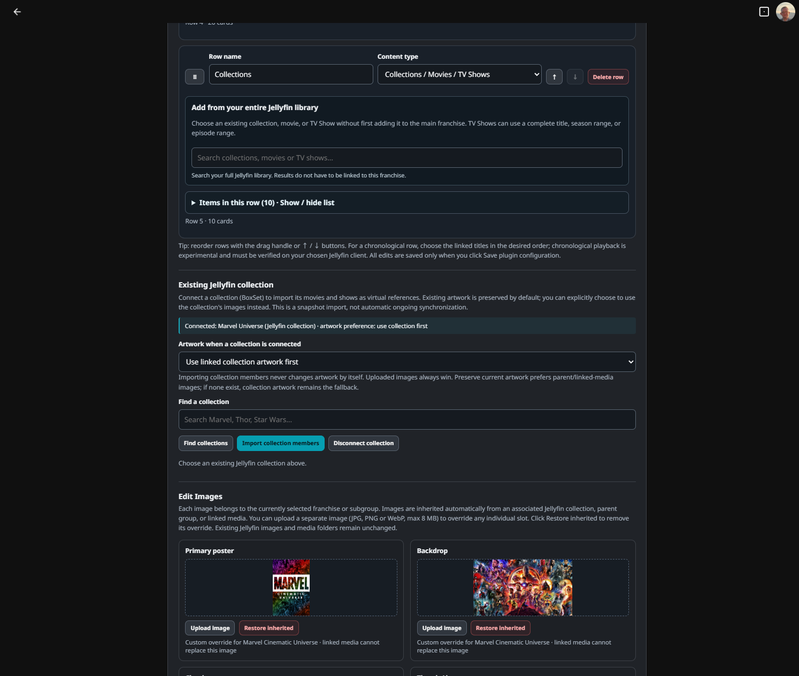

## Add existing Jellyfin media and episode ranges

The **Browse rows** section associates titles with the selected franchise or subgroup. The older separate **Linked Jellyfin media** search/manual-GUID section is hidden from the editor; existing saved references are preserved.

| Control | What it does |
| --- | --- |
| **Media selector inside a browse row** | Searches the full existing Jellyfin library by title. |
| **Select titles for a row** | Adds existing movies and TV shows as virtual references in that row. |
| **Reorder/remove a row item** | Changes what that row displays, without touching media files. |

### Search and add a title to one row

The examples below search **hulk** from inside the *Chronological Order* row. The search covers your **existing Jellyfin library**, so the results might include both a movie and a TV show even if neither is already attached to the selected franchise.

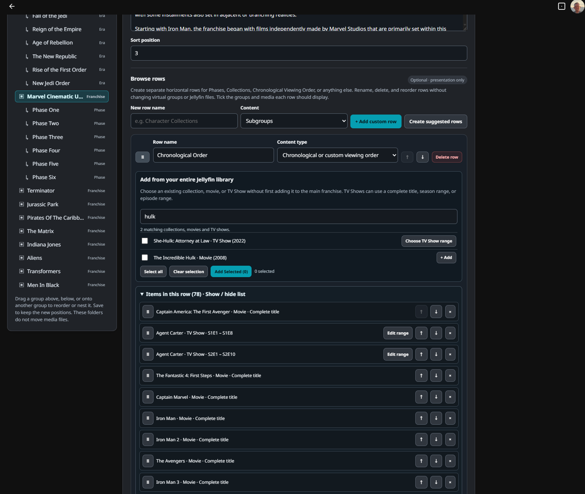

1. Search by title. Use **+ Add** to add one result immediately, or tick multiple results and choose **Add Selected (N)**.
2. For a TV show, use **Choose TV Show range** to limit it to a whole series, seasons, or start/end episodes.
3. Expand **Items in this row** to verify the entry was added. Move it to the desired place with its drag grip or arrow controls.
4. Use **Save plugin configuration** at the top when finished. A selected search checkbox by itself does **not** add that title.

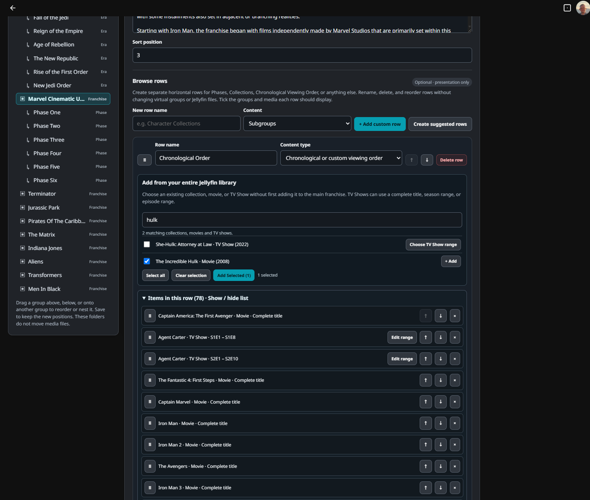

For a TV show, the **Choose TV Show range** dialog offers:

| Include option | What it includes |
| --- | --- |
| **Entire TV Show** | All seasons and episodes. |
| **Season to season** | Inclusive range from a starting season to an ending season. |
| **Season/episode to season/episode** | Inclusive boundaries for a precise episode span, including a span that crosses seasons. |

Use season/episode numbers **as Jellyfin lists them**. Specials use **Season 0**. Confirm the range dialog, review the entry in its chosen row, and then **Save plugin configuration**. For existing entries, use **Edit range** in the expanded list. Range support in automatic playback is experimental; verify the resulting order before relying on it.

Manual GUID entry is no longer displayed in the main editor. Existing linked GUID references remain stored; the usual workflow is to search Jellyfin titles from a row.

## Set up browse rows and chronological viewing order

Rows are configured **per selected franchise or subgroup** under **Browse rows**. They affect presentation only and do not create real Jellyfin collections or reorder your original library.

### Content types

| Content selector | Displays | Example |
| --- | --- | --- |
| **Subgroups** | Selected immediate child groups. | Phase One through Phase Six |
| **Collections / Movies / TV Shows** | Selected movie/show/collection cards. | Iron Man, Captain Marvel |
| **Chronological / custom viewing order** | A manually ordered sequence of media references with experimental playback/progress. | MCU chronological watch order |
| **Subgroups and media (where offered)** | A combination of selected child groups and media. | Collections plus individual specials |

### Create and edit rows

1. Enter **New row name**, choose **Content**, and click **+ Add custom row**. Or click **Create suggested rows**, which can add applicable Phase/Era/Saga/Collection rows and a **Chronological Viewing Order** row based on your current groups.
2. Use **Row name** to rename it and **Content type** to change what it accepts.
3. For subgroup rows, expand **Choose subgroups from [franchise]** and check the groups you want visible.
4. For media or chronological rows, use **Add from your entire Jellyfin library**. Search for existing titles, use **+ Add** or **Add Selected**, or **Choose TV Show range** for a series. **You do not need to link an item to the main franchise first** to use it in a row.
5. Reorder whole rows with the **⠿** grip or **↑ / ↓**. Reorder items *inside* each row with their own handles/buttons. If an item is a directly added TV series, **Edit range** can update its season/episode selection.
6. Use **×** to remove an entry from a row or **Delete row** to remove the whole presentation row. These actions do not delete media from Jellyfin.
7. Click **Save plugin configuration** before leaving the editor.

**For chronological playback:** Put titles in the exact sequence you intend. **Chronological / custom viewing order** does not automatically research or calculate a universe's canonical timeline. Progress is tracked separately from Jellyfin's regular watched flags; a watched marker in the franchise sequence should not be treated as proof of native Jellyfin watch history.

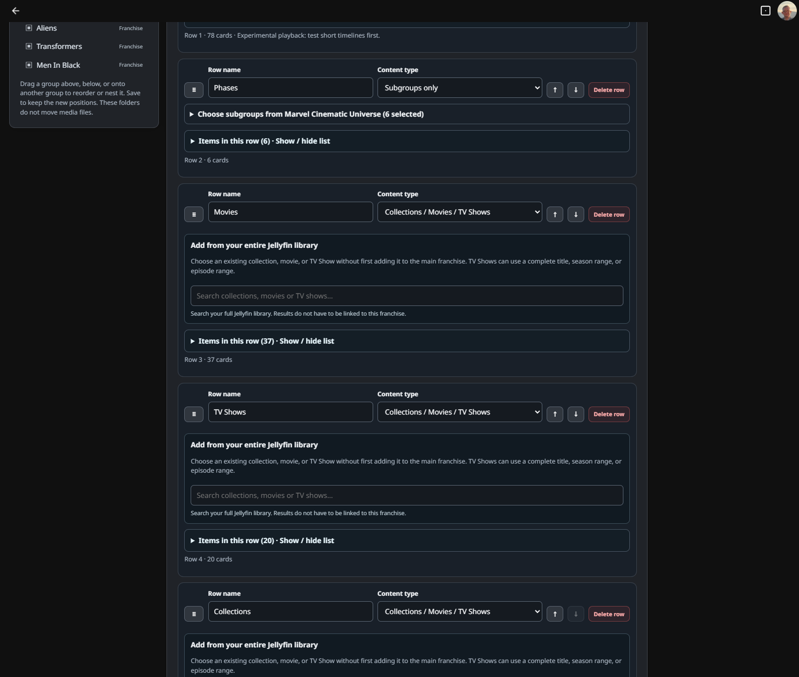

## Screenshots of the scrolling settings editor

These screenshots are placed **vertically in the order the settings sections appear**. Each covers a different portion of the long editor; repeated edges let you recognize where one scroll position meets the next. Expand only the part you need. All controls are actual examples from the uploaded v0.8.9.15 screenshots, not a default MCU configuration.

<details>
<summary><strong>1. Chronological Order — expanded items and precise TV ranges</strong></summary>

The example begins with *Captain America: The First Avenger*, then two selected *Agent Carter* season ranges, and continues through other films and TV ranges. The list shows **Edit range** only for eligible TV references. Use the left grip, **↑**, **↓**, or **×** to reorder/remove virtual references; you are not changing files.


</details>

<details>
<summary><strong>2. Phases row — selecting and ordering six subgroups</strong></summary>

**Subgroups only** displays checked child groups; here they are Phase One through Phase Six. Reordering the cards in this row does not move the franchise hierarchy or Jellyfin content.


</details>

<details>
<summary><strong>3. Movies row — expanding and arranging linked movies</strong></summary>

A Movies row uses **Collections / Movies / TV Shows** and contains a manually selected set of items, separate from the chronological sequence. The example below shows the expanded list and buttons for repositioning or removing a card.

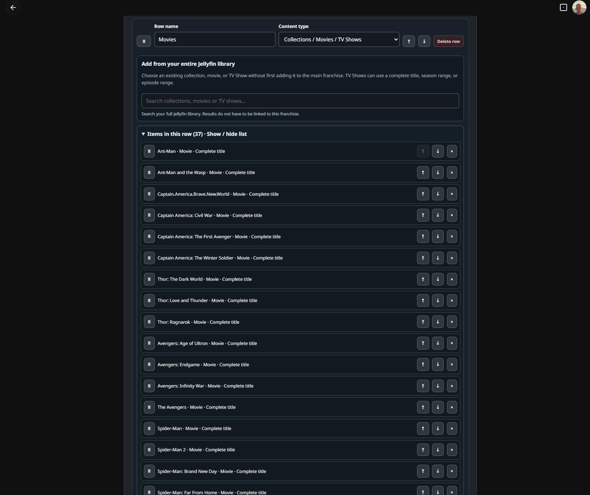

</details>

<details>
<summary><strong>4. TV Shows row — choosing ranges or full series</strong></summary>

**Edit range** appears beside TV show entries, including shows entered as complete titles. Select only the episodes relevant to the franchise if you do not want every episode displayed.

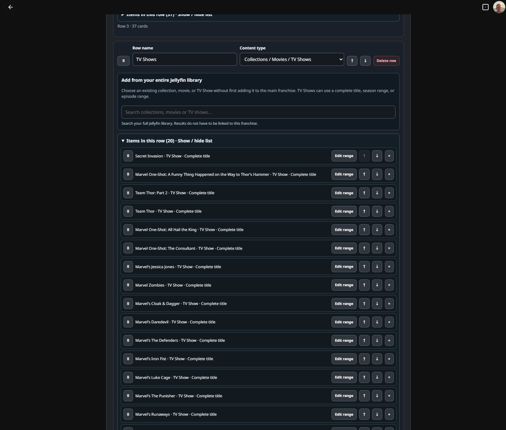

</details>

<details>
<summary><strong>5. Collections row — referencing native Jellyfin collections</strong></summary>

This row displays virtual links to native Jellyfin collection objects. Removing a linked collection from the row does **not** delete the native collection. The screenshot continues down into the **Existing Jellyfin collection** section of the editor.


</details>

## Franchises browser and viewer preferences

Click **Open Franchises browser** in the editor, or open the **Franchises** tile in Jellyfin Web's **My Media** section. The browser uses the Jellyfin login already active **on that same server and browser origin**.

To return to **Your franchises** from any franchise or subgroup, click the top-left **F logo** or the **Franchise Explorer** title. Both are one large, keyboard-accessible home link.

| Browser control | Behavior |
| --- | --- |
| **⚙ Settings** | Opens the administrator editor; administration permission is required. |
| **← Jellyfin** | Returns to Jellyfin Web. |
| **↑ Back** / breadcrumbs | Goes up to the parent franchise/group. |
| **Search this level...** | Filters visible entries at the current hierarchy level. It is not a full server search. |
| **Your order** | Uses the custom order saved in the editor. |
| **A to Z** | Alphabetical display order. Opening a franchise resets the selector to **Your order**; you can switch to alphabetical for that browsing session. |
| **☷ List** | Changes how cards are displayed at that level. |
| **Play chronological order** | Starts an experimental sequential watch order for that row. |
| **Episodes & progress** | Opens the timeline entry/progress view when available. |

### Two per-browser viewer preferences

These checkboxes are now located at the top of **Dashboard → Plugins → Franchise Explorer**, under **Playback & Home preferences**. They are no longer displayed on the viewer-facing browsing page.

| Setting | OFF (unchecked) | ON (checked) |
| --- | --- | --- |
| **Enable subtitles during Franchise Explorer playback** | Do not request subtitles from the plugin (default). | Request subtitles during supported plugin playback. Jellyfin client/player settings may override it. |
| **Hide franchise titles from Continue Watching and Next Up** | Keep franchise-linked titles in Jellyfin's native homepage rows (default). | Hide titles linked in the **entire saved active franchise chronological queue** from those **two** Jellyfin Web rows, even after a timeline reset; leave **Continue Your Franchises** visible. Other unrelated titles remain. |

The second switch is **ON = hide, OFF = show**, exactly as labeled. It is a **display-only** preference stored for the current Jellyfin user and browser; it does not change native watch data and will need to be set again on a different browser/device.

## Jellyfin homepage and mobile behavior

When JavaScript Injector is running the current Franchise Explorer script:

- **My Media → Franchises** opens the standalone browser. The text is centered over dimmed cinematic artwork. On desktop, the tile's three-dot menu appears when you **hover** over or keyboard-focus the tile; on touch screens, the control remains available. The menu's two actions are **Open Franchises** and **Franchise Explorer Settings**. Clicking the menu itself should not open the browser.
- Franchise posters show **TV Shows X · Movies Y** counts rather than a generic linked-item total. They count distinct titles, including nested groups and media added to custom rows; collection containers are excluded. The small **Franchise** badge is omitted, while era/phase badges remain.
- **Continue Your Franchises** appears for active supported watch orders and shows the franchise, current title, next episode where available, completion progress, and a resume action.
- The resume card uses the current movie or series **Primary poster** in **portrait, landscape, and desktop** layouts. Wide layouts can use a blurred fill behind the poster; turning your phone should not change the selected artwork or erase progress.
- If you enable the **Hide active franchise titles** viewer preference, the native **Continue Watching** and **Next Up** rows may no longer show the active title, while the franchise resume card remains available.

These features are injected into **Jellyfin Web**. Native Jellyfin Android TV, Roku, Apple TV, and other clients do not necessarily load or support them.

## Backups, troubleshooting, and current limitations

### Back up the right data

1. Click **Export backup** in the editor to save franchise groups, links, and rows as JSON.
2. Separately back up the plugin's uploaded artwork storage and your Jellyfin server configuration. The JSON file **does not include uploaded image bytes**.
3. Before a major restructure, keep a known-working export so you can use **Import backup** and **Save plugin configuration** to recover virtual metadata.

### Troubleshooting

| Symptom | Check |
| --- | --- |
| **No Franchises tile on Home** | Install/enable JavaScript Injector; confirm one current plugin-owned My Media script, restart Jellyfin, hard-refresh the browser. |
| **No homepage resume card** | Start a supported chronological watch order and check that the injected script loaded; not all clients support it. |
| **Resume Watch Order opens the franchise browser or chronological modal first** | The intended v0.8.9.15 Home behavior is direct video playback. Check the installed DLL and injected script version, disable duplicate older scripts, restart Jellyfin and hard-refresh, then try again. |
| **Next episode goes to a title Details page instead of playing** | The intended behavior is direct next-item playback. This remains experimental: check whether the media is playable from native Jellyfin Web, note whether the preceding item ended naturally or was manually skipped, and include your client/plugin versions in a bug report. **Details** should be an explicit menu choice. |
| **The three dots are not visible on desktop** | Hover or keyboard-focus the Franchises tile. The control is intentionally hidden at rest. |
| **Cannot find the Hide active titles switch** | Open **Dashboard → Plugins → Franchise Explorer** and look near the top for **Playback & Home preferences**. |
| **An active show disappeared from Continue Watching or Next Up** | Uncheck **Hide active franchise titles from Continue Watching and Next Up** in plugin settings. |
| **The franchise page has an empty row** | Select the correct group in the editor, check that the row includes matching groups/media, then save. An empty row does not imply missing Jellyfin files. |
| **Art is missing or wrong** | Verify the relevant group/slot, inheritance source, and any custom upload. **Restore inherited** affects only that slot. |
| **A backup import did not apply** | Import loads an unsaved workspace; click **Save plugin configuration** after reviewing it. |
| **A web page still shows an old UI** | After installing the compiled plugin update, restart Jellyfin and hard-refresh the browser. In the developer console, `window.__franchiseExplorerUiVersion` should display `0.8.9.15` for this release. |

### Limitations and safety

- This is unfinished software. Playback chaining, progress and navigation can vary by Jellyfin Web version/client.
- The plugin organizes **references**. It does not import films, download missing media, build a canonical chronological order automatically, or relocate files.
- The JSON backup and the plugin's uploaded images are **separate**. Retain both before upgrading or removing the plugin.
- All group/row/media edits require a final **Save plugin configuration**. Viewer preferences in plugin settings are stored separately in that user's browser.

For release-specific details, see [v0.8.9.15 upgrade instructions](../Jellyfin-Franchise-Explorer/docs/UPGRADE_V08915.md).
